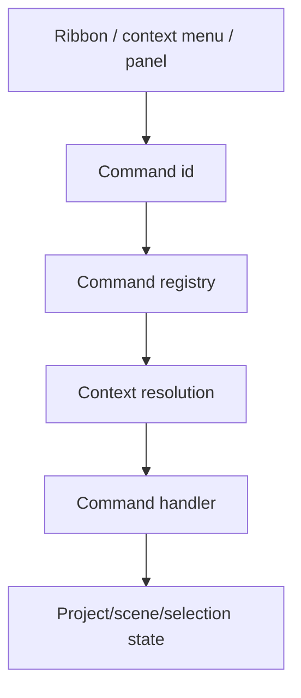

# SCADA Builder V2 - Menus And Surfaces Contract

Date: 2026-07-16
Status: Active editor menu and surface contract
Document version: `V2.1.6.0067`

## Historique des changements

| Date | Version | Commit | Changement |
| --- | --- | --- | --- |
| 2026-10-06 | `V2.1.6.0067` | `60843a9` | Légendes du catalogue `#N` nommant la feuille, et feuilles sans commande. (1) La légende (champ `Device`) nomme désormais chaque feuille contributrice avec sa source, par exemple `Paramètre — Condenseur_1 : {BP_1A_AUTO} · Condenseur_2 : {BP_1B_AUTO}`, dans un ordre déterministe (nom de feuille sans casse puis `SheetKey`), pour qu'un `#1` ne se lise plus comme lié à la seule feuille 1 quand deux feuilles le définissent ; une légende trop longue est coupée entre deux segments (suffixe ` · …`), jamais au milieu d'un nom de feuille ou d'une source. `DisplayName == Id == #N` est inchangé. (2) Une feuille n'a plus besoin d'une commande pour apparaître : les feuilles retenues sont celles liées à cette page plus celles liées à aucune page (feuille créée avant sa commande) ; une feuille liée uniquement à d'autres pages est exclue (elle appartient à une autre fenêtre rapide) ; si l'ensemble est vide, toutes les feuilles sont retenues. Cela remplace la règle « au moins une feuille liée ⇒ seules les feuilles liées ». Voir « Catalogue `#N` d'une page Fenêtre rapide » ci-dessous. |
| 2026-10-06 | `V2.1.6.0068` | `PENDING` | Catalogue `#N` d'une page Fenêtre rapide : toutes les feuilles de paramètres du projet comptent, sans filtrage par commande « Ouvrir une fenêtre rapide » (décision utilisateur). Suppression de `FindLinkedSheetKeys`, des ensembles « cette page / toute page », du repli, et du câblage d'instantané devenu inutile (`_quickWindowPageSnapshotScenes`, `RefreshQuickWindowPageSnapshotScenesAsync` et ses appels) ; `QuickWindowPagePlaceholderCatalog.Build(project, pageScene)` ne lit plus que le projet et la scène active (règle « non défini »). Libellé `Device` : `Paramètre — ex. : {BP_1A_AUTO}, {BP_1B_AUTO}`, sources distinctes sans nom de feuille, au plus 3 valeurs puis `, … (+N)`, 80 caractères maximum (valeurs entières retirées, première valeur coupée par `…` en dernier recours). Voir `docs/04_editor/MENUS_AND_SURFACES_CONTRACT_V2.md` § « Catalogue `#N` d'une page Fenêtre rapide ». |
| 2026-10-01 | `V2.1.6.0066` | `340c4fd` | Fix round 3 (régression sur page normale, revue) du correctif `#N` ci-dessous : le fix round 2 a remplacé la composition `{tag.DisplayName}` par `{tag.Id}`, raisonnement valable pour un `#N` (`DisplayName == Id`, DEC-0052) mais faux pour un tag de projet normal — un vrai catalogue a `Id` `tf100.mapping.161` et `DisplayName` `PE_16`, donc la règle lisait `{tf100.mapping.161} > 0` au lieu de `{PE_16} > 0`, l'identifiant que l'opérateur ne reconnaît ni ne sait modifier. `ScadaTagExpressionComposer.WrapTagToken` compose de nouveau depuis `DisplayName` dans les deux surchages (`ScadaTagDefinition` et `string`), correct pour un tag normal par construction et toujours correct pour un `#N` grâce à l'invariant round 2. `ExpressionCreationDialog.OnVariableClick` compose désormais depuis `tag.DisplayName` (plus `tag.TagId`). Le verrou de contrat `ElementStateRuleDialog_BuildExpression_KeepsDisplayNameInSource`, réécrit par erreur au round 2, est restauré — il lit maintenant `ScadaTagExpressionComposer.cs`, où vit la composition extraite, plutôt que `ElementStateRuleDialog.xaml.cs`. Voir « Catalogue `#N` d'une page Fenêtre rapide » ci-dessous. |
| 2026-10-01 | `V2.1.6.0066` | `921ba3a` | Fix round 2 (bug utilisateur) du correctif `#N` ci-dessous : l'éditeur d'état (Condition = Variable, « si vrai ») sur une page `QuickWindow` affichait `#1 — {BP_1A_AUTO} (Paramètre)` dans le sélecteur de tag et la validation échouait avec « Caractere inattendu : '}' ». Cause : `DisplayName` portait la description de la feuille (fix round 1) alors que `ElementStateRuleDialog`/`ExpressionCreationDialog` composent `{tag.DisplayName}` dans le texte source d'une expression et `ScadaExpressionValidator.TryResolveTagReference` le compare à un jeton analysé. `DisplayName` vaut désormais exactement `Id` pour chaque entrée `#N` (défini, multi-source, littéral, expression, non défini) ; la description vit dans `Device`. Nouveau `ScadaTagExpressionComposer` (`ScadaBuilderV2.App`, pur, testé) centralise la composition `{tag.Id}` et l'expression Variable complète, utilisé par les deux dialogues ; le hack d'étiquette round 1 de `TagSelectionDialog` (afficher `DisplayName` seul) est retiré, remplacé par `DisplayName · Device`. Audit des ~22 consommateurs de `DisplayName`/`Device` sur `ScadaTagDefinition` dans App/Application/Domain avant le changement : aucun autre champ n'est parsé, apparié ou persisté comme identifiant à partir de ces deux-là, hormis les deux sites corrigés. Voir « Catalogue `#N` d'une page Fenêtre rapide » ci-dessous. |
| 2026-10-01 | `V2.1.6.0066` | `c508579` | Revue (fix round 1) du correctif `#N` ci-dessous, commit `b31f443`. (1) La recherche de feuilles liées devient réellement project-wide — `MainWindow` capture un instantané cohérent de l'espace de travail à chaque activation d'une page `QuickWindow` et à chaque rafraîchissement du groupe « Fenêtres rapides » (`_quickWindowPageSnapshotScenes`), superposé aux scènes des onglets ouverts et à la scène active ; bon marché grâce à `SceneFileCache` (perf commit `dbd18bd`). (2) `Writeable` vaut vrai pour un `#N` non défini dans les feuilles (régression évitée sur un binding d'écriture déjà configuré) ou dont **toutes** les contributions Tag résolvent vers un tag inscriptible, même des tags différents entre feuilles ; faux dès qu'une contribution est un littéral/expression, ou qu'un tag ne résout pas, ou résout vers un tag non inscriptible (correctif d'une régression trouvée : `TableCellNumericInputInspector.cs`/`TableEditCoordinator.cs` filtrent le combo d'écriture sur `Writeable`). `Datatype` n'est renseigné que si toutes les contributions Tag résolues s'accordent. (3) Le tri numérique partagé `QuickWindowPagePlaceholderCatalog.OrderForSelector` couvre aussi `TagSelectionDialog`, `ElementReadVariableDialog` et `ElementEventDialog` (assistant d'expression, lecture de variable, évènements), pas seulement les deux sélecteurs d'état/commande déjà couverts. (4) La double étiquette `#1 — {X}  ·  #1  ·  type inconnu` de `TagSelectionDialog` est corrigée : un tag `#N` affiche uniquement son `DisplayName`, déjà complet. Mémoïsation de `BuildActiveQuickWindowPagePlaceholderCatalog` par référence (projet, scène active, instantané) pour ne pas reconstruire le catalogue à chaque résumé de binding (`FormatProjectTag`). Voir « Catalogue `#N` d'une page Fenêtre rapide » ci-dessous. |
| 2026-10-01 | `V2.1.6.0066` | `b31f443` | Fix bug utilisateur sur `Popup_Fan_Condenseur` (page `QuickWindow`) : le sélecteur de tag d'État → Ajouter proposait `#1, #10, #100, #101, …`, un catalogue statique `#1`..`#999` jamais basé sur les feuilles de paramètres. Nouveau `QuickWindowPagePlaceholderCatalog.Build` (`ScadaBuilderV2.Application.QuickWindows`, pur, testé) construit le catalogue `#N` depuis les feuilles liées à la page par une commande « Ouvrir une fenêtre rapide » (ou toutes les feuilles si aucune n'est encore liée), numériquement ordonné, avec un libellé montrant la source (`#1 — {FAN_03_RUN}`) et `Writeable`/`Datatype` repris du tag résolu. `ElementStateRuleDialog`/`ElementCommandDialog` ne re-trient plus ce catalogue par `DisplayName` (`QuickWindowPagePlaceholderCatalog.IsPlaceholderCatalog`), qui l'aurait remis dans l'ordre lexical ; le tri d'un catalogue de tags projet normal est inchangé. Voir « Catalogue `#N` d'une page Fenêtre rapide » ci-dessous. |
| 2026-09-30 | `V2.1.6.0061` | `c5d60b3` | Revue finale du chantier `2026-09-30-quick-window-parameter-sheets` (`DEC-PARAMSHEETS` = `DEC-0052`), correctifs I3, I4, M2 et M3 des surfaces. I3 : coller un élément porteur d'une commande « Ouvrir une fenêtre rapide » feuille/page (`ParameterSheetKey` et `QuickWindowPageKey` renseignés, aucune `QuickWindowInvocationKey`) ne déclenche plus le faux dialogue bloquant `MissingInvocationTarget` de `QuickWindowClipboardValidator` ; la commande collée garde sa paire. I4 : la branche de portée projet du rappel d'historique `RefreshTargetAsync` (`MainWindow.xaml.cs`) appelle aussi `RefreshQuickWindowGroupAsync()`, si bien qu'annuler/rétablir une mutation de feuille recharge le panneau « Fenêtres rapides ». M2 : le dialogue de règle écrit un tag par son nom lisible (`ParameterSheetEditorViewModel.TagReferenceFor`, repli sur l'id si le nom est vide, ambigu ou illisible par l'analyseur) au lieu de `{tf100.mapping.N}`, et `ParameterSheetEditorViewModel.ValidateRule` fait passer toute règle (Tag, Littéral, Expression) par l'analyseur de feuille avant l'ajout (expression invalide, `#N` déjà défini, guillemet dans un littéral). M3 : `ElementCommandDialog` ne propose plus les pages Fenêtre rapide comme cible de Navigate (`QuickWindowConfigurationRules.NavigateTargetPages`) et n'ouvre plus le sous-dialogue « Configuration de la fenêtre rapide » au chargement lors de l'édition d'une commande existante (`ShouldOpenConfigurationOnLoad` : création seulement, sinon bouton « Configurer… »). Détail : `.superpowers/sdd/2026-09-30-quick-window-parameter-sheets/final-fix-report.md` §I3, §I4, §M2, §M3. |
| 2026-09-30 | `V2.1.6.0054` | `27d4528` | Fix round 2 de revue de la Tâche 11 (`DEC-PARAMSHEETS` = `DEC-0052`) : correction Important — la combinaison des deux fix round 1 (`OnPageCommandCompleted` appelle désormais le rafraîchissement sur toute commande de propriété de page ; `SheetSelectorComboBox` est lié en écriture à `SelectedSheetKey`) faisait rejouer l'abaissement complet et recharger l'aperçu WebView2 à chaque commande de page sans rapport (composition, canevas, couleur de fond, validation…), avec un scintillement visible. `QuickWindowTestBenchViewModel.LoadPage` est désormais idempotent quand la page et l'ensemble ordonné des feuilles (clé + nom affiché) sont inchangés (aucun `Clear`, aucun `PropertyChanged`) ; un nouvel évènement `SheetSelected`, porté par le modèle (donc testable sans WPF), ne se déclenche que lorsque `SelectedSheetKey` change réellement hors d'une mise à jour programmatique (`LoadPage`/`Clear`, protégées par un drapeau interne) — une resynchronisation programmatique (page réellement changée, sélection conservée ; ou reforward du `SelectionChanged` WPF déclenché par la reconstruction de `Sheets`) ne relance donc plus jamais l'aperçu ; seul un choix authentique de l'opérateur le fait, exactement une fois. Le contrôle `QuickWindowTestBench` relaie désormais cet évènement sans aucune logique de garde dans le code-behind. Détail complet : `.superpowers/sdd/2026-09-30-quick-window-parameter-sheets/task-11-report.md` (section Fix round 2). |
| 2026-09-30 | `V2.1.6.0053` | `a2eb65d` | Fix round 1 de revue de la Tâche 11 (`DEC-PARAMSHEETS` = `DEC-0052`) : correction Important — `RefreshQuickWindowPageSurfaces` lisait le type de page depuis `_modernProject.Scenes`, observé avant la mutation pendant un résultat `page.set-type` (`OnPageCommandCompleted` assigne `_modernProject` puis appelle `ReplaceProject`, qui met à jour `tab.Page` de chaque onglet ouvert) ; elle lit désormais `_activeSceneTab?.Page.Type`, la même source que `BuildQuickWindowAuthoringContext`, et `OnPageCommandCompleted` appelle désormais le rafraîchissement après `ReplaceProject` pour qu'un changement de type soit reflété immédiatement, pas seulement à la prochaine activation d'onglet. Correction Important — `QuickWindowTestBenchLowering` ne portait dans son instantané que la feuille choisie et la page active ; une commande « Ouvrir une fenêtre rapide » authentique mais sans rapport, nichée dans le contenu de la page active et visant une autre feuille ou une autre page Fenêtre rapide, levait donc un faux `parameter-sheet.sheet-missing`/`parameter-sheet.page-not-quick-window` qui bloquait l'aperçu du couple réellement testé. L'instantané porte désormais toutes les feuilles du projet et toutes les références de page `QuickWindow`, et seul un diagnostic concernant la commande synthétique, la définition de la page active ou la syntaxe de la feuille choisie bloque désormais l'aperçu (`QuickWindowTestBenchLowering.IsBlocking`) ; tout autre diagnostic reste affiché, jamais bloquant. Correction Important — `QuickWindowPreviewDocumentFactory.BuildRegistry` omettait `Namespace` ; `quick-window-runtime.js` en a besoin pour construire `intent.namespace`, sans quoi l'adaptateur en ligne posait `data-qw-def="undefined"` et la fenêtre perdait son style namespacé. Correctifs mineurs : `SheetSelectorComboBox` est désormais lié en écriture à `QuickWindowTestBenchViewModel.SelectedSheetKey` (`SelectedValue`/`SelectedValuePath`), gardant la sélection synchronisée au changement d'onglet ; la ressource `GroupedMembers` (CollectionViewSource), devenue orpheline depuis que `QuickWindowInterfacePanel.xaml` ne montre plus la table de membres, est retirée. Détail complet : `.superpowers/sdd/2026-09-30-quick-window-parameter-sheets/task-11-report.md` (section Fix round 1). |
| 2026-09-30 | `V2.1.6.0052` | `a69f2b6` | Tâche 11 du chantier `2026-09-30-quick-window-parameter-sheets` (`DEC-PARAMSHEETS` = `DEC-0052`) : « Interface locale » et « Banc d'essai » sont rewirés sur la PAGE ACTIVE quand son type est `QuickWindow`, au lieu du chemin d'hébergement de définition devenu inaccessible depuis la Tâche 9 (`QuickWindowWorkspaceController.OpenAsync`/`ActivateQuickWindowAsync` n'ont plus aucun appelant produit ; conservés pour l'interface `IQuickWindowWorkspaceHost`, ils n'affichent plus ni `Interface locale` ni le banc). `QuickWindowInterfacePanelViewModel.LoadPlaceholders(ScadaScene)` (nouveau) liste en lecture seule les `#N` utilisés par la page active, triés par numéro, avec leur nombre d'usages et leurs emplacements (`QuickWindowPlaceholderUsageCollector`) ; les boutons Ajouter/Éditer/Supprimer membre disparaissent du panneau. Le banc d'essai gagne une déroulante de feuille de paramètres (`QuickWindowTestBenchViewModel.SelectSheet`/`LoadPage`) : la sélection construit une commande « Ouvrir une fenêtre rapide » synthétique (feuille + page active) sur un instantané en mémoire jamais écrit dans le projet (`QuickWindowTestBenchLowering`, nouveau), l'abaisse par `ParameterSheetLowering.Lower` et montre ses diagnostics dans le banc ; sans erreur, la définition et l'invocation abaissées alimentent `BuilderQuickWindowHostAdapter.OpenAsync` (nouveau paramètre optionnel `invocation`). `QuickWindowPreviewDocumentFactory` gagne un second script de montage (`QuickWindowPreviewInput.Invocation`) qui enregistre le couple définition/invocation dans `ScadaRuntime.QuickWindow.loadRegistries` puis mounte par `open`/`mountInstance` — la même substitution `#N` de mount-time que la Tâche 7 — au lieu de l'ancien chemin `QuickWindowHost.open` (conservé sans invocation, pour la fenêtre rapide DEC-0050 à ports nommés). Détail complet : `.superpowers/sdd/2026-09-30-quick-window-parameter-sheets/task-11-report.md`. |
| 2026-09-30 | `V2.1.6.0051` | `fa65e0c` | Fix round 2 de revue de la Tâche 10 (`DEC-PARAMSHEETS` = `DEC-0052`) : correction Important — introduite par le fix round 1, `ParameterSheetLowering.Lower` ne balayait la liveness des invocations que sur `resultScenes`, qui exclut délibérément toute page Fenêtre rapide, et jamais le contenu d'une définition ; une commande vivant DANS le contenu d'une page Fenêtre rapide (devenant le contenu d'une définition par cet abaissement) ou dans le contenu d'une définition `DEC-0050` pré-existante pouvait donc voir son invocation retirée à tort, sans diagnostic, transformant l'orphelin silencieux du round 1 en casse silencieuse. `CollectReferencedInvocationKeys` balaie désormais aussi le contenu de chaque définition du projet abaissé (les nouvelles, construites depuis les pages Fenêtre rapide de cet abaissement, et les pré-existantes conservées telles quelles), en plus des scènes abaissées, récursivement dans les enfants, de façon déterministe (scènes triées par clé de page, définitions dans leur ordre). Détail complet : `.superpowers/sdd/2026-09-30-quick-window-parameter-sheets/task-10-report.md` (section Fix round 2). |
| 2026-09-30 | `V2.1.6.0050` | `49f5d88` | Fix round 1 de revue de la Tâche 10 (`DEC-PARAMSHEETS` = `DEC-0052`) : correction Important — migrer une commande `OpenQuickWindow` d'un `QuickWindowInvocationKey` legacy vers une paire `ParameterSheetKey`/`QuickWindowPageKey` laissait l'ancienne `QuickWindowInvocation` orpheline dans `project.QuickWindowInvocations`, avec le même `OwnerPageKey`/`OwnerElementId`/`OwnerCommandId` que la commande migrée ; `ValidateQuickWindowInvocations` la valide sans condition, si bien qu'une définition supprimée ou un tag dérivé plus tard épingle une erreur de build/export à une commande qui semble pourtant correctement configurée, sans plus aucune UI pour la corriger. Corrigé aux deux bouts : (1) nouveau `QuickWindowInvocationMigration` (WPF-free, `ScadaBuilderV2.Application.QuickWindows`) détecte la migration (`InvocationKeyToRetire`) et retire l'invocation (`WithoutInvocation`) ; `QuickWindowInvocationService.RetireMigratedInvocation` applique la commande migrée et retire l'invocation orpheline comme une seule transition de workspace (`QuickWindowWorkspaceMutation`), poussée par `ApplyQuickWindowMutationAsync` comme une seule entrée d'historique projet — l'annulation restaure la commande et l'invocation ensemble. Câblé dans `ElementPropertiesDialog.OnEditCommandClick` (nouveau délégué `SaveMigratedQuickWindowCommand`) et dans `MainWindow.OnEditCommandClick` (le second appelant direct de `ElementCommandDialog`), les deux seuls sites où une migration peut survenir (l'ajout n'a jamais de commande d'origine). (2) Défense en profondeur dans `ParameterSheetLowering.Lower` : une invocation pré-existante n'est conservée que si une commande vivante des scènes abaissées la référence encore par son `QuickWindowInvocationKey` ; sinon elle est retirée du projet abaissé, sans lever de diagnostic. Détail complet : `.superpowers/sdd/2026-09-30-quick-window-parameter-sheets/task-10-report.md` (section Fix round 1). |
| 2026-09-30 | `V2.1.6.0049` | `bc5ebfb` | Tâche 10 du chantier `2026-09-30-quick-window-parameter-sheets` (`DEC-PARAMSHEETS` = `DEC-0052`) : dans `ElementCommandDialog`, choisir (ou déjà éditer) le type « Ouvrir une fenêtre rapide » ouvre le nouveau dialogue « Configuration de la fenêtre rapide » (`QuickWindowConfigurationDialog`) — une déroulante de feuille de paramètres, une déroulante de page `QuickWindow`, Annuler/Enregistrer (désactivé tant que les deux ne sont pas choisis) — qui remplace l'ancienne déroulante `QuickWindowDefinitionComboBox` unique ; Enregistrer produit `ParameterSheetKey`/`QuickWindowPageKey` sur la commande, sans plus jamais écrire d'invocation à l'authoring (l'abaissement `ParameterSheetLowering` s'en charge au build). L'onglet « Liaisons » disparaît de `ElementPropertiesDialog` pour toute commande `OpenQuickWindow` d'authoring. `ElementCommandKindCatalog.CreateOptions` prend désormais `hasQuickWindowPages`/`hasParameterSheets` séparés (au lieu de `hasQuickWindowDefinitions`) ; l'entrée « Ouvrir une fenêtre rapide » se grise avec `NoQuickWindowPageReason` et/ou `NoParameterSheetReason` (les deux concatenés si les deux manquent) — la règle « déjà utilisé » garde sa priorité. `CloseQuickWindow` (`isQuickWindowContent`) est désormais vrai exactement quand la page active est de type `QuickWindow` (`_activeSceneTab?.Page.Type == ScadaPageType.QuickWindow`), remplaçant l'ancien `IsQuickWindowSurfaceHosted` (la séparation « édition hébergée d'une définition ») dans `MainWindow.BuildQuickWindowAuthoringContext`. Une commande `OpenQuickWindow` pré-existante ne portant qu'un `QuickWindowInvocationKey` legacy (authoring `DEC-0050`, sans feuille/page) continue de se charger et de s'enregistrer inchangée tant que sa sélection feuille/page reste vide dans la session d'édition (`QuickWindowConfigurationRules.IsUnmodifiedLegacyInvocation`, WPF-free, testé). Détail complet : `.superpowers/sdd/2026-09-30-quick-window-parameter-sheets/task-10-report.md`. |
| 2026-09-30 | `V2.1.6.0048` | `83470f2` | Fix round 1 de revue de la Tâche 9 (`DEC-PARAMSHEETS` = `DEC-0052`) : correction Important — `QuickWindowWorkspaceController.DeleteSheetAsync` supprimait une feuille de paramètres sans confirmation même quand une commande « Ouvrir une fenêtre rapide » la référençait encore, contrairement à la suppression d'une définition de fenêtre rapide (`host.ConfirmQuickWindowDeletionAsync`) ; l'undo ne couvre cela que jusqu'à la fermeture du projet, après quoi l'opérateur découvre `parameter-sheet.sheet-missing` à la validation ou à l'export. Nouveau `ParameterSheetUsageFinder` (WPF-free, lié aux tests) recense chaque commande `OpenQuickWindow` dont `ParameterSheetKey` correspond, en parcourant les pages dans leur ordre projet et les éléments enfants récursivement. `DeleteSheetAsync` demande désormais confirmation via le nouveau `IQuickWindowWorkspaceHost.ConfirmParameterSheetDeletionAsync` (implémenté dans `MainWindow` par une `MessageBox` Oui/Non listant jusqu'à 10 appelants) uniquement quand des usages existent ; un refus ne produit aucune mutation ni entrée d'historique. Détail complet : `.superpowers/sdd/2026-09-30-quick-window-parameter-sheets/task-9-report.md` (section Fix round 1). |
| 2026-09-30 | `V2.1.6.0047` | `9bedd7c` | Tâche 9 du chantier `2026-09-30-quick-window-parameter-sheets` (`DEC-PARAMSHEETS` = `DEC-0052`) : le panneau « Fenêtres rapides » liste désormais les feuilles de paramètres du projet (plus les définitions de fenêtre rapide) ; son « + » demande un nom libre (`LibraryNameDialog`), crée la feuille et ouvre `ParameterSheetEditorDialog`. L'éditeur de feuille est un textarea monospace (`Consolas`) lié au texte, avec les diagnostics de `ParameterSheetParser` affichés ligne par ligne sous le texte ; son en-tête « + » ouvre `ParameterRuleDialog` (numéro `#N` proposé = premier libre, nature Tag/Littéral/Expression, déroulante du catalogue de tags pour Tag) qui ajoute une ligne via `ParameterSheetEditorViewModel.AppendRule` — un littéral contenant un guillemet est refusé (`ArgumentException`) plutôt que de produire une ligne que la grammaire ne pourrait pas relire. Créer/renommer/dupliquer/supprimer/éditer une feuille sont des mutations undoables (`QuickWindowWorkspaceController.CreateSheetAsync`/`RenameSheetAsync`/`DuplicateSheetAsync`/`UpdateSheetTextAsync`/`DeleteSheetAsync`), sur le modèle exact des mutations de définition existantes. L'entrée « + » de création de définition vide a été retirée de ce panneau (spec §9) ; les services de définition restent inchangés pour le compilateur. |
| 2026-09-30 | `V2.1.6.0046` | `8bf6539` | Fix round 1 de revue de la Tâche 8 (`DEC-PARAMSHEETS` = `DEC-0052`) : correction Critique — une page encore typée `Fragment` (sélecteur `Type` vide) était silencieusement convertie en `Default` au premier clic sur « Appliquer » touchant une autre propriété de page, car `OnApplyPagePropertiesClick` envoyait toujours `page.set-type` avec la valeur de repli `Default` de `GetSelectedPageType()`. `PageTypeOptions.ResolveRequestedType` retourne désormais `null` pour « aucune sélection » ; `GetSelectedPageType` devient nullable et ses deux consommateurs (`OnApplyPagePropertiesClick`, `OnPageTypeSelectionChanged`) n'envoient `page.set-type` que lorsqu'un type a été effectivement résolu — une sélection vide ne déclenche plus aucune requête de changement de type. |
| 2026-09-30 | `V2.1.6.0045` | `fa2c038` | Tâche 8 du chantier `2026-09-30-quick-window-parameter-sheets` (`DEC-PARAMSHEETS` = `DEC-0052`) : le sélecteur `Type` de la page retire `Fragment` de la sélection (reste affichable, libellé « Fragment (obsolète) », via `PageTypeOptions.Label`) et ajoute `Fenêtre rapide` ; mappage strictement par valeur (`PageTypeOptions.Selectable`), jamais par position de liste. Une page encore typée `Fragment` affiche le sélecteur vide ; la choisir convertit la page comme tout autre changement de type, via la même commande `page.set-type` (undoable). Le filtre de type du panneau Pages ajoute `Fenêtre rapide` et retire `Fragment` : une page héritée `Fragment` reste trouvable sous `Tous` mais ne correspond plus à aucun filtre de type nommé. Sur une page typée `QuickWindow`, les sélecteurs de tag (état, commande, liaison, expression) offrent un catalogue synthétique de jetons `#1`..`#999` au lieu du `Catalogue Tags` projet — même principe que la projection `Interface locale` ci-dessus, mais pour une page, pas pour une définition Fenêtre rapide hébergée. Voir `docs/00_governance/DECISION_REGISTER_V2.md` `DEC-0052`. |
| 2026-08-24 | `V2.1.5.0035` | `2e86fd9` | Surface de reparation des invocations `Outdated` : liste page/appelant/commande/motif, navigation vers l'appelant et reliaison port par port. |
| 2026-08-24 | `V2.1.5.0034` | `4202a70` | Dialogue de collage refuse : liste objet/propriete/reference/motif et deux issues seulement, `Annuler` ou `Coller sans liaisons`. |
| 2026-08-23 | `V2.1.5.0030` | `6c55fdb` | Banc d'essai Fenetre rapide : valeurs et titre temporaires, ouverture d'une instance d'apercu editor-only et fermeture explicite. |
| 2026-08-23 | `V2.1.5.0029` | `012135d` | Onglet conditionnel `Liaisons` du dialogue Proprietes : grille typee nom/famille/type/source/valeur/statut, selecteurs contextuels et banniere `Outdated`. |
| 2026-08-23 | `V2.1.5.0028` | `2fd6c72` | Panneau `Interface locale` : substitution du `Catalogue Tags` dans le contexte Fenêtre rapide, tableau unique groupé public/privé, filtres par famille, statut de liaison et compteurs d'usages. |
| 2026-08-23 | `V2.1.5.0027` | `ec6e6f7` | Ajout de la surface Fenêtres rapides : groupe projet distinct, projection canvas editor-only non exportable, lecture seule gardée et bandeau de contexte actif. |
| 2026-07-29 | `V2.1.5.0000` | `8fe1077` | Accueil projet, dialogue Nouveau, sélecteur `project.json`, récents et commandes de fermeture livrés. |
| 2026-07-16 | `V2.1.4.0042` | `9fd2a30` | `page.properties` ouvre et active maintenant la page selectionnee avant d'afficher le panneau Page afin de charger le bon snapshot de proprietes. |
| 2026-07-16 | `V2.1.4.0041` | `090d388` | Le groupe Input numerique est reduit a `Configurer <A1>` et partage une cible Tableau/cellule fraiche avec le panneau, le dialogue et le double-clic. |
| 2026-07-15 | `V2.1.4.0039` | `ce99ff9` | Le ruban contextuel Tableau expose le groupe Input numerique et route ses editions liees vers le controleur/dialogue dedies. |
| 2026-07-15 | `V2.1.4.0031` | `e127190` | Overflow du niveau 2 remplace par des chevrons sans barre native; hauteur reservee augmentee pour interdire le rognage vertical. |
| 2026-07-15 | `V2.1.4.0030` | `5d762bb` | Gestes Tableau rendus prioritaires en mode Cellules, reperes A/1 masquables, fusion contextuelle et coche de menu alignee a droite. |
| 2026-07-15 | `V2.1.4.0029` | `bbca8fa` | Niveau 2 du ruban densifie en commandes horizontales compactes sur deux rangees; galerie Formes et groupes visuels reduits. |
| 2026-07-15 | `V2.1.4.0028` | `c873744` | Entrée Tableau sans modale protégée; commande Verrou du ruban devenue toggle d'état et menu contextuel Element+ étendu à Verrouiller/Déverrouiller. |
| 2026-07-15 | `V2.1.4.0027` | `88e865a` | Ruban/panneau/menu Tableau complétés par distribution proportionnelle, marquage d'en-tête, reset de portée, dimensions exactes et état de format contextuel. |
| 2026-07-15 | `V2.1.4.0026` | `0874416` | Sous-surface Tableau contextuelle implementee dans le niveau 2 Inserer, creation configuree sans dialogue et modes Objet/Cellules exclusifs. |
| 2026-07-14 | `V2.1.4.0017` | `a94016a` | Niveau 1 du ruban Inserer compacte avec style independant afin de reserver la hauteur necessaire aux outils du niveau 2. |
| 2026-07-14 | `V2.1.4.0016` | `10cfa72` | Ruban Inserer hierarchique a huit familles et menu contextuel Tableau type tableur implementes depuis des catalogues dedies. |
| 2026-07-14 | `V2.1.4.0015` | `34dfc82` | Correction du clic droit Pages pour remonter correctement depuis un contenu WPF `Run` sans appeler `VisualTreeHelper` sur un objet non visuel. |
| 2026-07-14 | `V2.1.4.0014` | `fdcd11e` | Ajustement de l'icone Nouvelle page a 16x16 avec marge interne explicite pour eviter son rognage. |
| 2026-07-14 | `V2.1.4.0013` | `cc670c1` | Finition du panneau Pages : libelle Recherche, filtres initiaux Default/Tous et icone semantique partagee pour Nouvelle page. |
| 2026-07-14 | `V2.1.4.0012` | `50b2ad9` | Onglet Pages, actions rapides, menu contextuel, recherche/filtres et surfaces Diagnostics désormais implémentés. |
| 2026-07-14 | `V2.1.4.0011` | `4def659` | Ajout de la cible approuvée du ruban `Pages`, des actions rapides et du menu contextuel commun. |
| 2026-06-19 | `V2.1.3.0001` | `620e914` | Ajustement de la galerie Formes a des icones 32x32 sans libelles visibles. |
| 2026-06-19 | `V2.1.3.0000` | `b195fe0` | Ajout du contrat de galerie Formes 4 colonnes, icones 64x64, et etat actif d'insertion. |
| 2026-06-19 | `V2.1.2.0044` | `c50cbcf` | Extraction de la palette laterale d'outils vers la surface de commandes dynamique. |
| 2026-06-19 | `V2.1.2.0043` | `fde1b31` | Retrait du fallback XAML statique du ruban superieur. |
| 2026-06-19 | `V2.1.2.0042` | `0825cfe` | Les commandes `Grouper` et `Degrouper` du ruban Selection sont maintenant executees. |
| 2026-06-19 | `V2.1.2.0041` | `88a3e8b` | Le ruban WPF adapte le catalogue applicatif de commandes au lieu de posseder la liste canonique. |
| 2026-06-19 | `V2.1.2.0040` | `335adfb` | Le ruban superieur est maintenant rendu depuis un registre de commandes actif. |
| 2026-06-19 | `V2.1.2.0039` | `e5f8a82` | Ajout du contrat de ruban superieur groupe et icone pour les surfaces de commande. |
| 2026-06-17 | `V2.1.2.0013` | `4b01460` | Ajout du contrat de surface pour le panneau `Catalogue Tags` filtre. |
| 2026-06-16 | `V2.1.2.0003` | `940af93` | Ajout de la hierarchie parent/enfant dans l'onglet Element pour les groupes Element+. |
| 2026-06-16 | `V2.1.2.0002` | `2c5a0b4` | Ajout du contrat menu pour `object.group` et avertissement de conversion avant groupement legacy. |
| 2026-06-16 | `V2.1.2.0000` | `2c5a0b4` | Ajout du contrat du choix contextuel Propriete et des commandes desactivees avec raison visible au survol. |
| 2026-06-16 | `V2.1.1.0039` | `2c5a0b4` | Creation du contrat menus/surfaces separe des commandes et de l'UI generale. |

## Surface Fenêtres rapides

L’arborescence du projet possède un groupe `Fenêtres rapides` distinct, séparé des pages et de la bibliothèque Element+. Chaque entrée affiche son nom, son code, sa version d’interface, son nombre d’appelants et, le cas échéant, le nombre d’invocations `Outdated` à réparer.

Ouvrir une définition projette son `VisualContent` sur le canvas partagé au moyen d’une scène et d’une référence strictement editor-only : exclue du build, sans fichier durable, avec un code préfixé `qw-` qui ne peut entrer en collision avec une page. Cette projection n’est jamais ajoutée à `Project.Scenes`, donc aucun artefact d’éditeur ne peut atteindre un export.

Dans cette tranche, la projection est en lecture seule : tant qu’une Fenêtre rapide est affichée, le handler de messages du canvas est fermé, afin qu’aucune interaction ne puisse muter la dernière page active pendant que son contenu n’est pas celui affiché. L’édition du contenu appartient aux tranches d’authoring suivantes.

Un bandeau de contexte affiche en permanence le badge `Page` ou `Fenêtre rapide` et le titre de la surface active.

## Sélecteur de type de page

Le sélecteur `Type` du panneau Propriétés page (`PageTypeComboBox`) n'offre que `Défaut`, `Fenêtre rapide`, `En-tête` et `Pied de page` (`PageTypeOptions.Selectable`, `src/ScadaBuilderV2.App/Pages/PageTypeOptions.cs`), dans cet ordre. `Fragment` (`DEC-0052`) est retiré de la sélection ; son libellé reste défini (« Fragment (obsolète) », `PageTypeOptions.Label`) pour l'affichage d'une page qui le porte encore. Le mappage se fait strictement par la valeur `ScadaPageType` de l'option sélectionnée, jamais par l'index de la liste : retirer `Fragment` de la sélection ne décale donc jamais ce qu'un autre index signifiait. Une page encore typée `Fragment` affiche le sélecteur vide ; choisir un type la convertit comme tout autre changement de type, via la commande de page partagée `page.set-type` (`SetPageTypeCommand`), donc annulable comme les autres modifications des propriétés de page. Tant qu'aucun type n'est sélectionné, `PageTypeOptions.ResolveRequestedType` retourne `null` et aucune requête `page.set-type` n'est envoyée : appliquer les autres propriétés d'une page `Fragment` (titre, fond, dimensions…) ne la convertit jamais silencieusement en `Défaut` (fix round 1, Tâche 8).

Le filtre de type du panneau `Pages` (`PagesPanelViewModel.TypeFilters`) offre de même `Fenêtre rapide` à la place de `Fragment` ; une page héritée encore typée `Fragment` reste trouvable sous `Tous` mais ne correspond plus à aucun filtre de type nommé.

## Panneau Interface locale

Tant qu'une Fenêtre rapide est la surface active, le panneau `Catalogue Tags` du projet est masqué et remplacé par `Interface locale`. Le contenu d'une Fenêtre rapide ne référence jamais un tag physique du projet : les sélecteurs d'état, de commande, de liaison et d'expression consomment le catalogue de contexte, projeté depuis les membres de l'Interface locale de la définition ouverte. Cette projection est editor-only, reconstruite à chaque activation, jamais persistée ni exportée. Revenir sur une page restaure le catalogue de tags projet — sauf si cette page est elle-même typée `QuickWindow` (voir « Sélecteur de type de page » ci-dessus), auquel cas ses sélecteurs offrent le catalogue `#N` construit depuis les feuilles de paramètres liées à cette page (`QuickWindowPagePlaceholderCatalog.Build`, mémoïsé par référence depuis fix round 1, jamais le catalogue de tags projet) : plus de liste statique `#1`..`#999` triée comme du texte (fix bug utilisateur sur `Popup_Fan_Condenseur`, DEC-0052). Voir « Catalogue `#N` d'une page Fenêtre rapide » ci-dessous.

`Interface locale` est un tableau unique groupé en `Interface publique` et `Données privées`, filtrable par famille et par texte. Chaque ligne expose nom, famille, type, accès, requis, statut de liaison et compteur d'utilisations. Les propriétés courantes — nom, famille, type, accès, requis — sont modifiables directement dans le tableau; la famille impose l'accès et interdit `Requis` sur un membre privé. Les propriétés avancées — valeur par défaut et description — passent par le dialogue commun de membre, qui sert aussi la création.

Un port optionnel non lié est affiché en gris avec le statut `Non lié`; un port requis non lié est affiché en rouge. Chaque membre affiche son nombre d'utilisations et permet d'y naviguer; la page appelante est alors sélectionnée sans qu'aucune mutation ne soit produite. Supprimer un membre encore référencé exige une confirmation explicite qui liste les liaisons concernées; les invocations affectées deviennent `Outdated` et restent à réparer.

## Catalogue `#N` d'une page Fenêtre rapide

Sur une page typée `QuickWindow`, les sélecteurs d'état et de commande (`ActiveSelectorTagCatalog`, `MainWindow.QuickWindows.cs`) offrent un catalogue `#N` construit par `QuickWindowPagePlaceholderCatalog.Build` (`ScadaBuilderV2.Application.QuickWindows`), pur et testable, au lieu de l'ancienne liste statique `#1`..`#999` triée comme du texte (`#1, #10, #100, #101, …` — bug utilisateur sur `Popup_Fan_Condenseur`, DEC-0052) :

- **Feuilles retenues** : toutes les feuilles de paramètres du projet, toujours (décision utilisateur : « toutes les feuilles comptent »). Aucun filtrage par commande « Ouvrir une fenêtre rapide » : une feuille liée à cette page, à une autre page ou à aucune contribue de la même façon. Entrées, libellés, `Writeable` et `Datatype` dérivent de l'ensemble des feuilles.
- **Entrées** : l'union des `#N` définis (`ParameterSheetParser.Parse`) dans les feuilles du projet, plus tout `#N` que la page référence elle-même (scène active) mais qu'aucune feuille ne définit (marqué « non défini » pour ne jamais faire disparaître la valeur d'un état existant).
- **Ordre** : numérique croissant (`#1, #2, …, #10`), jamais lexical. Le tri partagé `QuickWindowPagePlaceholderCatalog.OrderForSelector` (fix round 1) détecte ce catalogue (`IsPlaceholderCatalog`) et n'applique pas le tri habituel par `DisplayName`, qui le remettrait dans l'ordre `#1, #10, #100…` ; tous les sélecteurs de tag l'utilisent (`ElementStateRuleDialog`, `ElementCommandDialog`, `TagSelectionDialog`, `ElementReadVariableDialog`, `ElementEventDialog`), et le tri par `DisplayName` d'un catalogue de tags projet normal reste inchangé partout.
- **Libellé** (fix round 2, bug report) : `Id` reste exactement `#N` (contrat persisté, inchangé) et `DisplayName` **doit toujours lui être égal exactement** — `DisplayName` est un champ porteur d'identifiant dans toute l'application (`ElementStateRuleDialog`/`ExpressionCreationDialog` composent `{tag.DisplayName}` dans une expression via `ScadaTagExpressionComposer`, `ScadaExpressionValidator.TryResolveTagReference` le compare à un jeton `{...}` analysé), jamais un champ d'affichage seul. La légende vit dans `Device` à la place : les sources distinctes (sans nom de feuille), par exemple `Paramètre — ex. : {BP_1A_AUTO}, {BP_1B_AUTO}` (ordre : nom de feuille sans casse puis `SheetKey` ; littéral `"texte"`, expression `{TAG} * 0.1` ; au plus 3 valeurs, puis `, … (+N)` pour les N non affichées ; 80 caractères au maximum : des valeurs entières sont retirées et comptées dans `+N`, et seule la première valeur, si elle ne tient pas seule, est coupée avec `…`) ou `Paramètre — (non défini dans les feuilles)`, un champ audité comme purement textuel dans tous ses consommateurs (`AuthoringLabel`, les auxiliaires `TagLabel`, le panneau Catalogue Tags et son filtre « Appareil », qui ne voient jamais ce catalogue). Avant ce correctif, `DisplayName` portait la description et composer `{tag.DisplayName}` produisait `{#1 — {FAN_03_RUN}}`, non analysable (« Caractere inattendu : '}' »).
- **Writeable/Datatype** (fix round 1) : `Writeable` vaut `true` pour un `#N` non défini dans les feuilles (régression évitée sur un binding d'écriture déjà configuré) ou dont **toutes** les contributions `ParameterValueKind.Tag` résolvent vers un tag projet inscriptible — même des tags différents entre plusieurs feuilles liées ; `false` dès qu'une contribution est un littéral/expression, ou qu'un tag ne résout pas, ou résout vers un tag non inscriptible. `Datatype` n'est renseigné que si toutes les contributions Tag résolues s'accordent sur le même type, sinon absent.
- Câblage : `MainWindow.BuildActiveQuickWindowPagePlaceholderCatalog` n'a besoin que du projet et de la scène active, mémoïsés par référence avec la clé de page ; aucun instantané de l'espace de travail n'est capturé pour ce catalogue.

## Onglet Liaisons

L'onglet `Liaisons` du dialogue Proprietes Element+ n'apparait que lorsque la commande selectionnee est une commande `OpenQuickWindow` resolue vers une definition; toute autre commande le masque et vide sa grille.

La grille expose, pour chaque port public de la definition : nom, famille, type, source, valeur ou reference et statut. Chaque ligne choisit d'abord son type de source parmi `Tag`, `Litteral`, `Expression` ou `Port parent`, puis presente le selecteur contextuel correspondant; changer de source efface la valeur typee precedente. `Port parent` n'est propose que lorsque l'appelant vit dans le contenu d'une Fenetre rapide.

Un port optionnel non lie apparait en gris avec le statut `Non lie`, un port requis non lie apparait en rouge. Une invocation `Outdated` affiche une banniere rouge, marque en rouge ses ports a reparer et ses ports retires, et laisse build et export bloques jusqu'a reparation.

L'editeur n'ecrit jamais dans le workspace : il valide les liaisons contre le domaine et emet une demande d'enregistrement que le shell applique comme une transition unique annulable.

## Banc d'essai Fenetre rapide

Le banc d'essai est une surface editor-only. Il liste les ports publics de la definition active et permet de fournir, par port, un tag temporaire et une valeur temporaire, plus un titre d'instance temporaire. Ces donnees ne sont jamais persistees dans le modele, jamais validees comme liaisons durables et jamais exportees.

`Ouvrir l'apercu` materialise une instance sous la racine d'apercu de l'editeur et l'affiche dans le banc; `Fermer l'apercu` la retire. Chaque demande recoit une generation strictement monotone et son propre identifiant d'instance temporaire, de sorte qu'une hydratation obsolete soit rejetee de facon deterministe.

L'apercu presente le chrome minimal contractuel : backdrop partage, cadre `role="dialog"`, barre de titre et bouton `X`. `Escape` et `CloseQuickWindow(Self)` ferment la meme instance; un clic sur le backdrop ne ferme jamais.

## Frontiere presse-papier page / fenetre rapide

Le contenu d'une fenetre rapide ne reference jamais un tag physique du projet et une page ne reference jamais un membre d'Interface locale. Tout collage, duplication ou instanciation d'un composant de bibliotheque franchissant cette frontiere est analyse avant insertion.

Le refus est le comportement par defaut. Le dialogue de collage refuse liste chaque reference fautive avec son objet, sa propriete, la reference et le motif, et n'offre que deux issues : `Annuler` ou `Coller sans liaisons`. Aucun collage partiel silencieux n'est propose.

`Coller sans liaisons` retire chaque reference fautive et laisse la propriete `Non lie`. Rien n'est reecrit, remappe ni promu automatiquement en membre d'Interface locale, et le collage reste une transition unique annulable dans le contexte cible.

Sont egalement refuses : un port appartenant a une autre definition, une reference qui ne resout nulle part dans une fenetre rapide, une invocation dont la definition cible a disparu et une invocation deja possedee par un autre appelant, une invocation ne pouvant jamais etre partagee entre deux appelants.

## Surface de reparation des invocations Outdated

Le panneau `Interface locale` expose l'action `Reparer les invocations`. Elle ouvre une surface qui liste, pour la definition active, chaque invocation laissee `Outdated` par une evolution d'Interface locale avec sa page, son element appelant, sa commande, le couple de versions et le motif exact d'incompatibilite.

L'operateur y navigue vers l'appelant, ou relie l'invocation port par port au moyen de la meme grille de liaisons typees que l'onglet `Liaisons`. Aucune reparation automatique ni en masse silencieuse n'existe : une invocation est reparee a la fois, le realignement n'a lieu que lorsque plus rien ne casse, et chaque reparation est une transition unique annulable de la pile de workspace.

Toute modification d'Interface locale qui rendrait des invocations `Outdated` est confirmee au prealable : le nombre d'invocations impactees et leurs appelants sont affiches avant application, et un refus laisse la definition inchangee. Build et export restent bloques tant qu'une seule invocation reste a reparer.

## 1. Contract

Menus and surfaces expose commands. They do not own business behavior.

Surfaces include:

1. Ribbon.
2. Context menus.
3. Left tool panel.
4. Right property panel.
5. Status bar diagnostics.
6. WebView bridge menus.
7. Studio Element+ ribbon and structure surfaces.
8. Project tag catalog panel.

## 2. Menu Flow

## 3. Rules

1. A menu item must map to a command id or documented UI-only diagnostic action.
2. Context menus must preserve current selection before invoking selection-sensitive commands.
3. Menu labels may change for UX, but command ids remain stable.
4. Hidden or disabled menu behavior must match command enablement.
5. Disabled context-menu entries remain visible when they explain a blocked workflow; the disabled reason must be exposed as a hover warning or equivalent accessible hint.
6. The `Propriete` context-menu entry opens Element+ properties for converted objects and remains disabled for non-converted source objects with a conversion warning.
7. The Element+ context menu exposes `Grouper` only for multi-selection of modern scene objects.
8. The source/legacy context menu must not expose a destructive legacy frame-group workflow; when group intent is visible for source nodes, it must direct the user to convert to Element+ first.
9. The Element tab must preserve Element+ group hierarchy by displaying group children as child rows rather than independent flat siblings.
10. The `Catalogue Tags` panel is a read-oriented project catalog surface. It lists imported tags with id, name, datatype, device, address, access, and state.
11. The `Catalogue Tags` panel must expose filters for text search, device, datatype, access, and state. These filters affect the displayed list only and must not mutate `ScadaProject.TagCatalog`.
12. The `Catalogue Tags` panel must show a filtered summary so users can distinguish the visible filtered subset from the full imported catalog.
13. The top ribbon must expose an active tab state and group commands by user task family rather than by implementation detail.
14. A visible ribbon command must have a stable label, tooltip, command route or documented disabled reason, and semantic icon key.
15. Disabled future commands may remain visible only when they communicate roadmap intent or preserve a familiar command location; they must not look executable.
16. Long command families must use scrolling, wrapping, galleries, or grouped overflow so buttons are not clipped at the application minimum width.
17. Insert-ribbon commands must use normalized vector icon keys. Temporary text glyphs are not valid command-surface icons.
18. The top ribbon renderer consumes the active command registry for the selected tab. Static XAML button duplication is not allowed in the main shell ribbon.
19. The top ribbon command list is defined in `ScadaBuilderV2.Application.Commands.RibbonCommandCatalog`; the WPF shell is responsible only for resource lookup, visual templates, and dispatch adaptation.
20. The `Selection` ribbon may execute `Grouper` and `Degrouper` for Element+ objects. Legacy/source selections still use the existing conversion warning rather than a direct legacy grouping workflow.
21. The left tool panel palette consumes semantic command metadata from `RibbonCommandCatalog.CreateToolPalette()` and must not duplicate `Icon.Tool.*` resources directly in static XAML buttons.
22. The Insert ribbon `Formes` group must render as a shape gallery with at most four icons per row, 26x26 semantic shape icons, no visible shape-name labels inside the gallery buttons, and tooltip labels for discoverability.
23. Active insertion commands must show selected state until the placement completes or is cancelled. Starting another placement replaces the active command state.
24. `insert.shape.line` and `insert.shape.arrow` use a two-point placement surface: first click captures start, second click commits the Element+ object, and Escape cancels placement.
25. The Element+ context menu exposes `object.open-in-element-studio` ("Ouvrir dans Studio Element+") for a single selected converted object only when it was instantiated from a library `.sep` (tracked via `ScadaElementData.TagBinding`); otherwise it is visible but disabled with the reason "Cet objet n'a pas ete instancie depuis la bibliotheque Element+".
26. The first-level Insert family selector must use a compact style independent from second-level command buttons so the active tool groups remain fully visible inside the normalized ribbon height.
27. `Inserer > Donnees > Tableau` conserve le niveau 1 compact et remplace le niveau 2 par les groupes Creation, Mode, Selection, Contenu, Structure, Format, Dimensions et En-tetes; Retour Donnees restaure les outils generiques.
28. La configuration 1..64 du prochain Tableau est visible dans le ruban. Aucun dialogue modal n'est ouvert avant le clic canvas.
29. `object.lock` affiche `Verrouiller` lorsque toute cible n'est pas verrouillée et `Déverrouiller` uniquement lorsque toute la fermeture de sélection est verrouillée; le ruban Sélection et le menu contextuel partagent cet état.
30. L'indicateur supérieur immédiatement à gauche de `SCADA Builder V2` distingue aucune sélection, déverrouillé, verrouillé et mixte, tout en conservant le même point de commande.
31. Les groupes de commandes du niveau 2 utilisent deux rangees compactes, des boutons horizontaux de 28 px et des icones de 16 px; les libelles trop longs sont tronques visuellement mais restent disponibles en entier dans leur info-bulle.
32. En mode Tableau Cellules, les cellules, inputs, poignees de pistes, double-clic et menu contextuel possedent les gestes avant le drag Element+; `Masquer A/1` retire les reperes d'edition sans masquer les poignees de largeur/hauteur.
33. Le groupe contextuel `Input numerique` est actif seulement pour une cellule ancre `InputNumeric` appartenant au Tableau courant. Il expose uniquement `table.numeric.properties`, libelle `Configurer <A1>`; Lire et Ecrire restent des sections de son dialogue unique et ne sont plus des commandes visibles. Le ruban, le panneau et le dialogue partagent le meme id Tableau/adresse A1, et le double-clic ouvre la cellule emettrice validee sans ajouter de logique de mutation dans `MainWindow`.
33. La coche d'une commande contextuelle active est placee apres son libelle afin de conserver l'alignement gauche commun des commandes.
34. Le niveau 2 n'affiche aucune barre de defilement native. Lorsque sa largeur depasse la surface disponible, deux chevrons paginent horizontalement les groupes; la hauteur reservee doit conserver les deux rangees entierement visibles.

## 4. Implemented Pages Surfaces

The approved `DEC-0038` target adds a top-ribbon tab named `Pages`, quick actions in `Projet > Pages`, and a page context menu. All three surfaces use the same `page.*` command ids, enablement, disabled reasons, results, confirmations, history, and diagnostics.

The project panel is sourced from modern `ScadaProject.Scenes`, exposes a labelled search field plus type/build filters, and never displays `PageKey`. The initial filters are `Default` for page type and `Tous` for build inclusion. The quick-create button reuses the same semantic `Icon.Page.New` resource as the ribbon. Right-click alone selects without opening and safely handles inline WPF content such as `Run`; double-click, Enter or `page.open` performs explicit activation. Invoking `page.properties` also opens and activates the selected page before the Page panel is shown, so its reference and scene snapshot are coherent and all edits target the displayed page. F2, Ctrl+D and Delete are scoped to the Pages list. The bottom Diagnostics panel and modern blocking dialog consume one structured issue collection and navigate internally by key while showing only the human page code.

## 5. Related Tests

`tests/ScadaBuilderV2.Tests/WebViewContextMenuScriptTests.cs`

`tests/ScadaBuilderV2.Tests/StudioElementPlusContractTests.cs`

`tests/ScadaBuilderV2.Tests/PageManagementSurfaceContractTests.cs`

`tests/ScadaBuilderV2.Tests/DiagnosticsSurfaceContractTests.cs`
