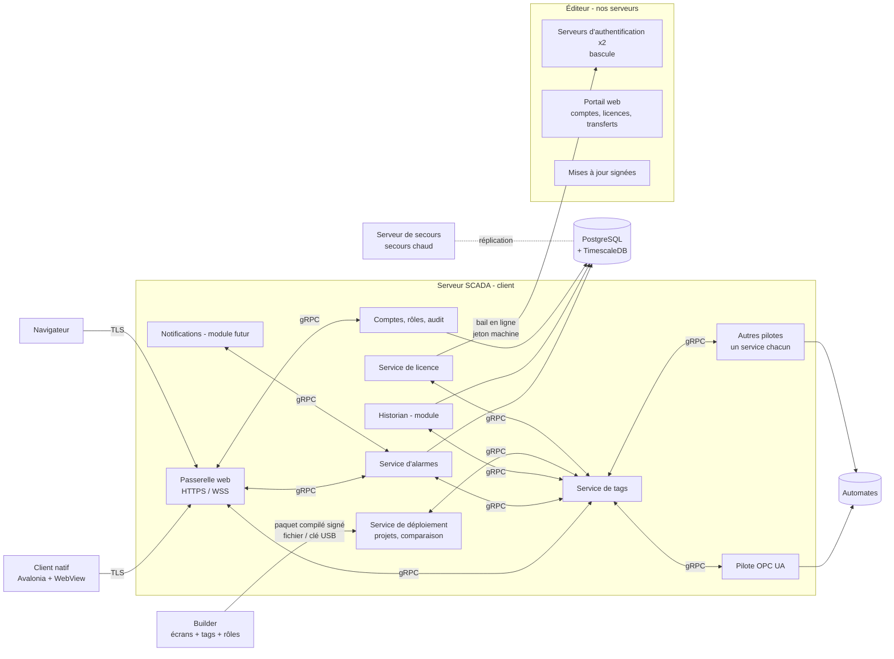
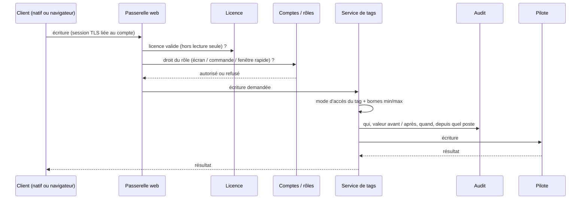
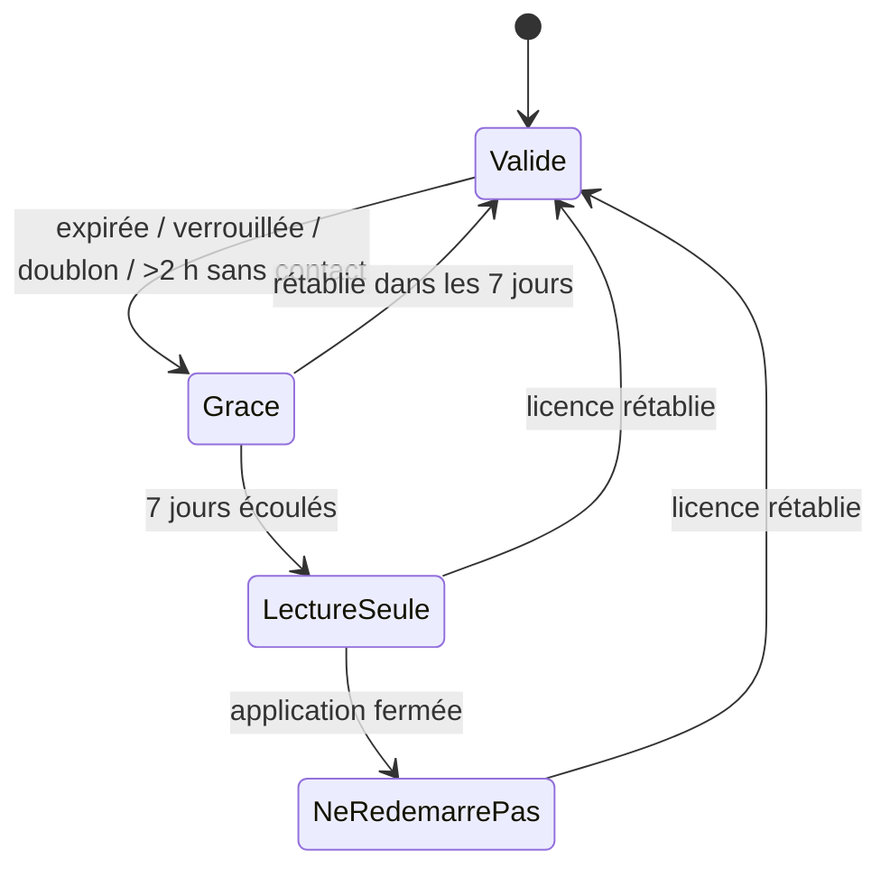

# Socle d'architecture — Scada AnyWare 2027 (serveur, tags, licences et sécurité) - Spécification

Date: 2026-10-15
Status: Approved - DEC-0055 (architecture cible ; rien n'est implémenté)
Document version: `V2.1.6.0073`
Portée: **Scada AnyWare 2027** — serveur SCADA (services, tags, pilotes, alarmes, stockage, redondance), clients d'exploitation, Builder (création des tags, déploiement), système de licences, comptes, rôles, audit, conformité et mises à jour. **Scada AnyWare Lite** (ex-TF100Web, embarqué dans le TF100) n'est couvert que là où il est nommé (§2, §17).
Dépendances: `docs/superpowers/specs/2026-09-08-project-format-versioning-and-converters-design.md` (format de projet), `docs/03_runtime_contracts/FT100_TF100WEB_PACKAGE_CONTRACT_V2.md` (paquet actuel, inchangé). Notes d'entrevue sources, non versionnées : `Claude outputs/licences-notes-2026-10-06.md` (Q1–Q20) et `Claude outputs/pilotes-tags-notes-2026-10-06.md` (P1–P18).

## Historique des changements

| Date | Version | Commit | Changement |
| --- | --- | --- | --- |
| 2026-10-15 | `V2.1.6.0073` | `PENDING` | Création du document de socle à partir des entrevues du 2026-10-06 et du 2026-10-15 : toutes les réponses Q1–Q20 (licences et sécurité) et P1–P18 (serveur, pilotes, tags) intégrées, avec table de traçabilité (annexe A) et points de tension à confirmer (§19). Ajouts du 2026-10-15 au soir : Builder renommé Scada AnyWare Windows Maker (complet + fork Lite `.sb2`), nouveau dépôt Scada AnyWare, pilote PCCC (SLC 500 / MicroLogix) natif, FINS TCP et PCCC en phase 1. `DEC-0055`. |

## 1. Objet et règles de lecture

Ce document regroupe **toutes les décisions prises par l'utilisateur** lors des entrevues du 2026-10-06 et du 2026-10-15 sur la suite Scada AnyWare 2027. Il sert de socle aux deux spécifications de détail qui suivront :

1. **Pilotes et tags** (service de tags, pilotes, dictionnaire, modèles, format du paquet) ;
2. **Licences et sécurité** (format signé, activation, portail, comptes, rôles, audit, mises à jour).

Conventions :

- Chaque règle cite sa source entre crochets : **[Qn]** = questionnaire licences et sécurité, **[Pn]** = questionnaire serveur, pilotes et tags, **[§x.y]** = décision consignée dans les notes licences hors questionnaire, **[D-2026-10-15]** = décision de l'utilisateur du 2026-10-15 hors questionnaire (dépôts, Maker, pilotes de la phase 1).
- Une **recommandation de Claude** non confirmée par l'utilisateur est marquée *(recommandation — à confirmer)*. Tout le reste est décidé.
- C'est une architecture cible : **aucun comportement décrit ici n'est implémenté** dans SCADA Builder V2 ni dans TF100Web au 2026-10-15.

## 2. Produits

| Produit | Description | Source |
| --- | --- | --- |
| **Scada AnyWare 2027** | Suite PC : Maker, serveur SCADA, clients d'exploitation, modules. | [§4] |
| **Scada AnyWare Windows Maker** (version complète) | Nouveau nom du Builder. SCADA Builder V2 en devient la base et évolue progressivement : développement du serveur et des clients d'exploitation (tags, rôles, paquet compilé). | [D-2026-10-15] |
| **Scada AnyWare Windows Maker Lite** (fork) | Fork limitée au **paquet `.sb2` pour TF100Web** (Scada AnyWare Lite) ; garde le contrat TF100Web protégé actuel. Le Maker complet **garde aussi l'export `.sb2`** pendant la transition ; il sera décommissionné au besoin plus tard. | [D-2026-10-15] |
| **Scada AnyWare Lite** | Version embarquée dans l'appareil **TF100** ; le projet TF100Web actuel en est la version alpha/bêta, disponible seulement sur le TF100. **Priorité : que ça fonctionne sur le TF100.** Son modèle de licence est lié à l'appareil et n'est pas défini séparément pour l'instant. | [Q19] |
| Lite redistribuable (futur) | Runtime compilé, sous licence pour fabricants d'appareils, **à la manière de CODESYS**. Très basse priorité. | [Q19] |

- **Organisation des dépôts** [D-2026-10-15] — remplace le « dépôt unique » des notes du 2026-10-06 [§4] :
  - **nouveau dépôt Scada AnyWare** : Maker complet, serveur et ses services, pilotes, client natif, licences ; créé à partir de SCADA Builder V2 (fork qui garde l'historique), parce que l'extension va peu à peu diverger de façon incompatible avec le projet actuel ;
  - **dépôt actuel SCADA Builder V2** : devient le Maker Lite, limité au `.sb2` pour TF100Web ; son contrat de paquet protégé ne change pas.
  - Dans le dépôt Scada AnyWare, la différenciation entre produits se fait par modules inclus et par licence, **pas par branches git**. [§4]

## 3. Plateformes

| Composant | Plateformes | Source |
| --- | --- | --- |
| Windows Maker (complet et Lite) | **Windows seulement** | [§4], [D-2026-10-15] |
| Serveur SCADA | **Windows obligatoire, Linux idéalement** ; installation classique **et** déploiement **Docker** (déploiement plus rapide, meilleure résilience). | [P2] |
| Client natif | **Windows + Linux (Debian/Ubuntu)**, compilé (ex. NativeAOT) et durci contre l'ingénierie inverse. | [§4], [P17] |
| Client navigateur | Tout navigateur moderne, même rendu que le client natif. | [P11] |
| Service de validation de licence | Windows et Ubuntu. | [§1.1] |

## 4. Vue d'ensemble

---

# Partie A — Serveur, pilotes et tags

## 5. Organisation du serveur

Le serveur est composé de **plusieurs services séparés et découplés** qui communiquent entre eux. Un pilote qui plante ne fait pas tomber le reste ; une mise à jour (nouveau pilote, correctif de sécurité) ne touche que le service concerné. [P1]

| Service | Responsabilité |
| --- | --- |
| Passerelle web | Sert les écrans et l'API aux clients ; TLS ; sessions liées au compte ; décompte des licences client (§13). |
| Service de tags | Dictionnaire des tags, valeurs courantes, mise à l'échelle, routage vers les pilotes, contrôle des écritures (§9.2). |
| Pilotes | **Un service par pilote** ; communication avec les automates. |
| Service d'alarmes | Évalue les objets alarme ; état, acquittement, historique (§8). |
| Historian | Module licencié à part ; enregistre les tags marqués « historiser ». [§1.3] |
| Notifications externes | Module futur « à la WIN-911 » (projet parallèle intégré plus tard), licencié à part ; l'abonnement au fournisseur SMS/appels n'est pas géré par nous. [§1.3] |
| Service de licence | Vérifie le fichier de licence signé, maintient le bail en ligne, détecte les doublons (Partie B). |
| Comptes, rôles, audit | Comptes SCADA ou AD/LDAP, rôles, permissions, journaux d'audit (§15, §16). |
| Service de déploiement | Plusieurs projets, un seul actif ; comparaison, activation, retour arrière (§10). |

## 6. Communication et pilotes

### 6.1 Entre services

- **gRPC local**, contrats typés et versionnés, natif .NET, Windows / Linux / Docker ; valeurs de tags en flux (streaming). [P14]

### 6.2 Pilotes

- **Pilotes natifs** livrés avec la suite : **OPC UA, Modbus TCP, EtherNet/IP, Siemens S7, MQTT, Omron FINS TCP et FINS UDP**, et **Allen-Bradley SLC 500 / MicroLogix (« RS500 », protocole PCCC)**, passé de paquet optionnel à pilote natif de l'offre initiale [P3], [D-2026-10-15]. **Transport : Ethernet** (PCCC encapsulé sur EtherNet/IP — SLC 5/05, MicroLogix 1100/1400), celui des appareils de test. Le DF1 série n'est pas prévu dans l'offre initiale ; il reste possible en paquet.
- **Pilotes spécifiques en paquets installables** qui s'ajoutent à la bibliothèque : par exemple Allen-Bradley PLC-5, Mitsubishi (MELSEC/SLMP), LoRaWAN. [P3]
- Conditions d'architecture [P3] :
  - **contrat de pilote stable et versionné** (gRPC, §6.1) ;
  - chaque pilote tourne dans **son propre service** ;
  - paquets **signés avec la clé de l'éditeur** (IEC 62443) ;
  - installation et mise à jour **indépendantes** ;
  - certains paquets peuvent être **licenciés comme modules additionnels**.
- **Tout nouveau pilote doit être signé par l'éditeur** avant installation, sans exception pour l'instant. [P4]
- **Kit de développement de pilotes : retenu, pas en phase 1.** Peut être annoncé en marketing. Plus tard, des **partenaires externes de confiance** pourront être habilités à signer : la chaîne de confiance doit être **extensible dès la conception**, sans être activée au départ. [P4]

## 7. Modèle de tag

### 7.1 Identité

- **Identifiant interne stable et invisible + nom lisible.** Le nom (ex. `PE_16`) se renomme librement ; écrans, alarmes et liaisons suivent, car ils référencent l'identifiant. [P7]
- Cet identifiant **remplace à terme `tf100.mapping.N`** et sert aussi à la comparaison serveur / Builder (§10). **Migration des projets existants à prévoir.** [P7]

### 7.2 Organisation

- **Arborescence de dossiers + modèles réutilisables (UDT)** : on définit une fois un type (ex. « moteur » : Auto, Manuel, Départ, Arrêt, Marche), puis on crée des instances (M120A, M120B…). [P8]
- Une instance de modèle pourra **remplir automatiquement la feuille de paramètres d'une fenêtre rapide** (ex. M120A → `#1 := {M120A/Auto}`). [P8]

### 7.3 Propriétés [P9]

| Groupe | Propriété | Précision |
| --- | --- | --- |
| Base | Type de donnée | Bool, entiers, réels, chaîne… |
| Base | Unité d'ingénierie | °F, PSIG, %, Hz… |
| Base | Mode d'accès | Lecture seule ou lecture/écriture. |
| Base | Description | Texte libre lisible. |
| Ingénierie | Mise à l'échelle brute → ingénierie | **Appliquée par le serveur.** |
| Ingénierie | Limites min/max d'écriture | **Toute écriture hors bornes est refusée par le serveur, quel que soit l'écran.** |
| Ingénierie | Bande morte | Variation minimale avant mise à jour. |
| Ingénierie | Période de scrutation | Fréquence de lecture. |
| Historisation | Historiser + intervalle | Pour le module Historian. |

### 7.4 Création, modification et routage

- **Les tags sont créés dans le Builder** (licence de développement), avec des **outils d'import rapide**. [P5]
- **Ne pas prendre TF100Web comme acquis** : c'est un volet à part (devenu Lite). [P5]
- **Sur le serveur : modification seulement** (ex. corriger l'adresse d'un nœud OPC UA), **aucune création** : un tag créé sur le serveur ne serait lié à rien (écrans, alarmes), et la création relève de la licence de développement. [P5]
- La modification sur le serveur est **réservée à un rôle habilité** et **journalisée** (§16). [P5]
- **L'adresse détermine le pilote** : au déploiement, l'adressage est analysé pour router chaque tag vers son pilote. [P5]

## 8. Alarmes

- **Objets alarme séparés** (modèle FactoryTalk A&E / Ignition) : chaque alarme **référence un tag par son identifiant stable** et porte sa condition, sa priorité, son message, son délai et son groupe. [P10]
- **Plusieurs alarmes par tag** (H, HH, L, LL…) et conditions sur expression entre plusieurs tags. [P10]
- **Les alarmes de base sont incluses dans tout serveur**, sans module à acheter. [§1.3]
- Acquittement réservé au rôle **Superviseur** et plus [Q10], **journalisé** [Q12].

## 9. Points de contact entre tags et licences

Organisation retenue le 2026-10-06 : deux specs séparées, précédées de ce socle qui fixe leurs **trois points de contact**.

### 9.1 Nombre de tags configurés

- Le service de tags expose le **nombre de tags configurés** ; le service de licence le compare au palier acheté (1000, 2000, 3000…) **au démarrage**. [Q17]
- **Un serveur qui dépasse le plafond de sa licence ne démarre pas** : le client réduit ses tags ou achète un palier supérieur. [Q17]
- **Pas de modification à chaud** : pour mettre à jour le SCADA, l'opérateur arrête le SCADA, déploie, puis remet en service ; **la remise en service échoue si le palier est dépassé**. [Q17]

### 9.2 Chemin d'écriture vers l'automate

Toute écriture suit ce chemin, quel que soit l'écran ou le client :

- Permissions à **trois niveaux, tous requis** : par écran, par commande, par fenêtre rapide. [Q11]
- Bornes min/max appliquées **par le serveur**. [P9]
- Journal : qui, valeur avant/après, quand, depuis quel poste. [Q12]
- En lecture seule (après la grâce de 7 jours), les écritures sont refusées. [Q1], [Q20]

### 9.3 Architecture du serveur

Services, démarrage, Docker ou machine nue et redondance : §5, §11 et §3. **Un conteneur se clone trivialement et son empreinte machine est faible** : la protection y repose sur le bail en ligne et la détection de doublon, qui restent efficaces. [P2]

## 10. Déploiement et cycle de projet [P6]

Constat : FactoryTalk (surtout View ME) écrase sans protection une modification serveur oubliée ; Ignition l'évite par une copie unique du projet sur le serveur avec détection de conflit. Notre modèle (projet Builder + déploiement) ressemble à FactoryTalk ; d'où les règles suivantes.

- **Plusieurs projets sur le serveur, un seul actif** ; les précédents sont conservés → **retour arrière** possible.
- **Mise à jour** : on dépose dans un outil du serveur le **fichier compilé par le Builder** ; le serveur le **compare au projet actif, y compris aux modifications faites sur place**, et **rapporte erreurs et divergences avant toute activation**.
- **Retour vers le Builder** : le serveur **exporte ses modifications locales** ; le Builder les **réintègre automatiquement**.
- Comparaison et retour **limités au dictionnaire des tags** (seul élément modifiable sur le serveur).
- **Conflit** (même tag modifié des deux côtés) : **jamais tranché automatiquement** ; l'outil montre les deux valeurs et **l'utilisateur décide**.
- Le paquet compilé doit contenir le **dictionnaire des tags sous forme structurée, avec des identifiants stables** : évolution du format de paquet à spécifier dans le volet pilotes et tags. Le contrat `.sb2` actuel avec TF100Web reste inchangé.
- Avantage : fonctionne **sans connexion Builder ↔ serveur** (transfert par fichier ou clé USB).
- Rappel : pas de modification à chaud ; le déploiement se fait SCADA arrêté (§9.1). [Q17]

## 11. Redondance

### 11.1 Serveur SCADA chez le client

- **Redondance prévue dès le départ.** [Q18]
- **Secours chaud** : le secours tourne en parallèle et lit les tags **sans écrire vers les automates** ; **bascule automatique** en quelques secondes si le principal ne répond plus ; **les clients se reconnectent seuls**. [P16]
- **Base de données répliquée** entre principal et secours. [P15]
- **Le serveur de secours relève d'une licence particulière**, vendue à part et liée au serveur principal : **seule exception encadrée** à la règle « jamais deux serveurs sur une même licence ». [Q18]

### 11.2 Serveurs de l'éditeur

- Serveur d'authentification et portail **hébergés sur nos propres serveurs** ; des serveurs 24/7 existent déjà pour les tests. [Q16]
- Avant la production : **montée en capacité et redondance** (bassin de serveurs extensible, postes de redondance). [Q16]
- **Deux serveurs d'authentification indépendants dès le départ** (Docker, machine nue ou autre ; sur la même machine au début). La **bascule doit exister et être validée**. [Q16]
- Ce service est **critique pour tout le parc** : une panne de plus de 2 heures ferait entrer tous les clients en grâce (§12.3) → haute disponibilité et supervision. [Q2]

## 12. Stockage

- **PostgreSQL + TimescaleDB** pour l'historian, l'historique des alarmes et les journaux d'audit ; installé avec la suite ou en Docker ; réplication pour la redondance. [P15]
- Le stockage de Lite n'est pas tranché. [P15]

## 13. Clients d'exploitation

- **Navigateur + client natif** : le serveur sert les écrans en web (même rendu que Lite / TF100Web) ; le client natif encapsule ce rendu, durci et licencié. [P11]
- **Client natif : Avalonia + WebView** — un seul code .NET pour Windows et Linux, compilable en NativeAOT ; WebView2 sous Windows, WebKitGTK sous Linux. [P17]
- **Ne rien embarquer dans le client qui vaille d'être volé** : licence vérifiée en natif avec réponse signée du serveur, pilotes dans un service, code signé, contrôle d'intégrité au démarrage, aucun secret. [§4]
- Le moteur d'affichage actuel est en JavaScript (lisible) : à trancher dans la spec du client — JS obscurci, logique sensible en WebAssembly, ou rendu natif. [§4]
- **TLS obligatoire** : HTTPS / WSS seulement, aucun HTTP en clair. **Certificat auto-signé généré à l'installation**, remplaçable par celui du client. Session liée au compte de l'utilisateur. [P12]
- **Une session navigateur consomme une licence client flottante** et la libère à la déconnexion, après un délai d'inactivité. Le client natif est nommé ou flottant. [P13]

---

# Partie B — Licences, sécurité et conformité

## 14. Système de licences

### 14.1 Principes de construction [§1.1]

- **Construit en interne. Aucune dépendance à un fournisseur ou service tiers.** Maintenance plus lourde acceptée : le logiciel n'est pas grand public.
- **On écrit nous-mêmes** : le format de licence, les règles (types, droits, expiration, postes), l'empreinte machine, le service de validation (Windows et Ubuntu), le service web d'activation (« comme FactoryTalk Activation »), le portail, la révocation et le transfert.
- **On n'invente pas d'algorithmes cryptographiques** : `System.Security.Cryptography` de .NET — signature **ECDSA P-256 ou RSA-PSS**, chiffrement **AES-GCM**, hachage **SHA-256**.
- **La clé privée de signature ne quitte jamais un poste sécurisé chez l'éditeur.** Le runtime ne contient que la clé publique : il vérifie une licence, il ne peut pas en fabriquer.

### 14.2 Gamme de licences [§1.3]

| Licence | Liée à | Prix selon |
| --- | --- | --- |
| **Développement** (Builder) | un poste (§14.6) | moins cher que le runtime, mais payant |
| **Serveur** (runtime) | **un seul serveur — jamais deux serveurs sur une même licence** | **palier de tags** : 1000, 2000, 3000… |
| **Serveur de secours** | lié au serveur principal | vendu à part [Q18] |
| **Client** | **poste nommé OU flottante** — les deux, vendues comme produits distincts | à l'unité ou en **lots** de 3, 5, 10… |
| **Historian** | module ajouté au serveur | à définir |
| **Notifications externes** | module ajouté au serveur | à définir (+ abonnement fournisseur SMS/appels, non géré par nous) |
| **Paquets de pilotes** | modules possibles [P3] | à définir |
| Alarmes de base | incluses dans tout serveur | — |

- **Pas de limite de simultanéité au-delà de ce qui a été acheté** : limiter en plus un client payé serait restrictif.

### 14.3 Format de licence [Q4]

- **Un seul fichier de licence signé par serveur**, listant tous ses droits (palier de tags, historian, notifications, clients nommés et flottants…). Chaque module vérifie son propre droit.
- **Nouveau produit ou palier = nouveau droit, sans changer le format** ; compatible avec la maintenance additive.
- Fichier **signé et daté** (valide du … au …) : une fois expiré, il ne fonctionne plus. [§1.4]

### 14.4 Activation et types de licence

| Type | Règles | Source |
| --- | --- | --- |
| **Standard** | **Accès web obligatoire** : activation et bail en ligne. **Plus de 2 heures sans contact avec le serveur d'authentification → période de grâce automatique de 7 jours**, pour forcer le rétablissement d'Internet ; à l'échéance, lecture seule (§14.5). | [§1.4], [Q2] |
| **Hors ligne** (payante, type particulier) | Clients totalement isolés ; pas là qu'on met le plus d'énergie. Fichier valide **1 an**, renouvelé par échange de fichier (aligné sur le contrat de maintenance annuel). **Rappels à 60 et 30 jours.** À l'échéance : 7 jours de grâce, puis lecture seule. **Risque accepté** : une copie d'un site hors ligne peut tourner jusqu'à un an sans détection ; le dongle pourra être ajouté pour les gros sites. | [§1.4], [Q2], [Q3] |
| **Dongle maison** | Puce standard à élément sécurisé (défi/réponse, clé privée dans la puce). Accepté, **priorité faible**. | [§1.4] |

### 14.5 Expiration, verrouillage et grâce

- Licence **expirée ou verrouillée** → **fenêtre contextuelle** et **7 jours de grâce** pour rétablir. [Q1]
- **On ne ferme jamais l'application** en cours d'exécution. [Q1]
- **Une fois la grâce terminée : lecture seule jusqu'à la fermeture, et l'application ne peut plus redémarrer.** Si elle est fermée pour une cause externe, le SCADA ne redémarre pas ; l'éditeur n'en est pas responsable. [Q20] — voir le point de tension §19.1.

### 14.6 Licence de développement (Builder)

- **Poste nommé seulement pour commencer**, avec transfert lors d'un changement d'ordinateur. [Q6]
- **La licence flottante reste une avenue importante** (grosses équipes) : format et service conçus pour l'ajouter **sans refonte**. [Q6]
- **Licence de développement ponctuelle, payable au mois**, achetable sur la plateforme. [Q7]
- **Essai de 7 jours** possible, **pas en téléchargement libre** : octroyé par le **réseau de revendeurs** ou l'**équipe marketing**. [Q20]

### 14.7 Licence serveur

- **Attribuée à un compte**, comme les autres licences (§14.8). [Q8]
- Activation en se connectant **une fois** sur le serveur avec un compte actif ; ensuite le serveur **maintient lui-même sa connexion authentifiée** au serveur d'authentification (**jeton machine**), sans personne connectée devant le serveur. [Q8]
- **Jamais gratuite pour l'instant.** Le mécanisme d'essai serveur peut exister comme option technique, sans usage prévu. [Q20]

### 14.8 Comptes, portail et transferts (modèle « à la Autodesk ») [Q7]

- **Chaque licence est attribuée à un compte.** Le **responsable du groupe de travail** attribue les licences aux comptes depuis un **portail web**.
- L'utilisateur **se connecte avec son compte depuis le logiciel**, qui valide la licence auprès du serveur d'authentification. Changer de poste = se déconnecter de l'ancien, se connecter sur le nouveau.
- **Transfert en libre-service** : licence **standard** limitée à **1 transfert par 30 jours** ; compte **premium** : **transferts illimités**.

### 14.9 Protection contre la copie et la duplication

- **Détection de deux serveurs ou de deux clients sur la même licence → la licence est verrouillée** ; le client doit appeler le service à la clientèle. [§1.4]
- **Doublon détecté = même traitement qu'une licence échue** : invalidée, 7 jours de grâce, puis lecture seule. Situation anormale : elle signifie un partage ou une copie contraire aux règles. [Q1]
- **Protections actives partout** [Q5] :
  - **détection sur le réseau local** (deux serveurs avec la même licence se repèrent) ;
  - **scellement TPM** sur les serveurs physiques ;
  - **protection contre le recul d'horloge**.
- Protection en couches contre le clonage de machines virtuelles *(recommandation — à confirmer pour le détail)* :

| Moyen | Contre le clonage de VM | Limite |
| --- | --- | --- |
| Bail en ligne | **Fort** | connexion requise (règle des 2 h) |
| Dongle à élément sécurisé | **Fort**, même hors ligne | matériel, logistique, passage USB vers la VM |
| TPM | fort en physique, **faible en VM** | lié au matériel |
| Détection réseau local | moyen | inefficace si le clone est isolé |
| Fichier signé à courte durée | faible | contrainte administrative |

  Une clé USB simplement chiffrée **ne protège pas** (copiable) ; seule une clé à élément sécurisé résiste à la copie.

### 14.10 Preuves de contrefaçon et cadre légal

- **Protocole de capture** en cas de doublon : adresses IP, MAC, empreinte machine, horodatage et tout élément utile à établir la contrefaçon. [§1.4], [Q15]
- Données **déclarées de façon claire et transparente** dans les termes et conditions, **limitées** à l'établissement de la contrefaçon, **conservées de façon sécurisée pendant 3 ans**. [Q15]
- Cadre : **Loi 25** (Québec), **RGPD** si clients européens. Technique : rapport d'incident signé et horodaté transmis au service de l'éditeur *(recommandation — à confirmer)*. [§2.4]
- **Termes et conditions revus par un avocat avant la mise en marché**, et rédigés pour permettre des poursuites. [§1.4], [Q15]

## 15. Comptes et rôles des utilisateurs du SCADA

- **Deux modes au choix à l'installation** : comptes gérés par le SCADA lui-même, ou rattachés à l'annuaire du client (**Active Directory / LDAP**). [Q9]
- **Quatre rôles de base fournis** [Q10] :

| Rôle | Droits |
| --- | --- |
| Opérateur | écrans + commandes courantes |
| Superviseur | + acquittement des alarmes, consignes |
| Technicien / Ingénieur | + réglages avancés, diagnostics |
| Administrateur | + comptes, configuration |

- **Le développeur peut créer ses propres rôles personnalisés dans le Builder**, avec des droits sur mesure. [Q10]
- **Permissions à trois niveaux, tous requis** : **par écran** (page visible ou non), **par commande** (bouton / écriture réservé à un rôle), **par fenêtre rapide** (popup ouvrable ou non). [Q11]
- La modification d'un tag sur le serveur est réservée à un rôle habilité. [P5]

## 16. Journal d'audit [Q12]

| Journal | Contenu |
| --- | --- |
| Connexions | connexions / déconnexions |
| Écritures | qui, valeur avant / après, quand, depuis quel poste |
| Alarmes | acquittements |
| Projet | déploiements et modifications de projet, dont les modifications de tags sur le serveur [P5] |

- **Journaux séparés et indépendants** pour chaque catégorie.
- **Rétention : 6 mois par défaut, configurable.**
- Stockés dans PostgreSQL (§12).

## 17. Conformité [Q13]

- **IEC 62443 visée dès le départ** (cybersécurité industrielle) : TLS obligatoire [P12], pilotes et mises à jour signés [P3], rôles et audit [Q10–Q12].
- **FDA 21 CFR Part 11 prise en charge**, sous forme d'un **mode activable/désactivable par le développeur** lors de la conception de son SCADA (signatures électroniques, traçabilité renforcée).
- Principe : intégrer **dès le départ** les options les plus modernes et les plus strictes, beaucoup plus simple qu'après coup.

## 18. Mises à jour

- La maintenance se fait **de manière additive par des mises à jour**. [§1.2]
- **Correctifs signés** (même infrastructure de clés), infalsifiables par un client. [§1.2]
- **En ligne et hors ligne** (fichier transporté sur clé USB pour les sites isolés). [§1.2]
- **Versionnés, avec retour arrière.** [§1.2]
- Applicables au **Builder, aux clients runtime et aux services** ; un service se met à jour sans toucher aux autres. [§1.2], [P1]
- L'outil de téléchargement **peut être intégré au logiciel**. [Q14]
- **Téléchargement et installation strictement à la demande de l'utilisateur. Aucune mise à jour automatique, même de sécurité** : on ne redémarre jamais un serveur sans autorisation. [Q14]

---

# Partie C — Suite des travaux

## 19. Points de tension à confirmer

Ces points découlent de la combinaison de réponses ; ils ne sont **pas tranchés** et doivent l'être avant la spec de détail concernée.

1. **Redémarrage impossible après la grâce [Q20] vs sécurité du procédé.** Si un SCADA en lecture seule s'arrête pour une cause externe (panne de courant), il ne redémarre plus : l'usine perd sa supervision **et ses alarmes** (ammoniac, compresseurs), avec un risque pour les personnes et une responsabilité juridique pour l'éditeur, que les termes et conditions ne couvriront pas forcément. *Recommandation de Claude [§2.3] : dégrader sans arrêter — autoriser le redémarrage en lecture seule avec alarmes actives et bandeau permanent « licence verrouillée, contactez le support », en bloquant déploiements, modifications, ajout de clients et écritures.*
2. **Périmètre exact de la lecture seule** : les alarmes continuent-elles de s'afficher et de s'acquitter ? L'acquittement est une action, pas une écriture vers l'automate.
3. **Comptage des tags [Q17] avec les modèles [P8]** : chaque membre d'une instance de modèle compte-t-il comme un tag ? Les tags internes (calculés, mémoire) comptent-ils ?
4. **Secours chaud [P16]** : le secours lit les automates en parallèle, ce qui double la charge de communication ; à valider sur les automates anciens (PLC-5/SLC) et les liens lents.
5. **Délai d'inactivité** d'une session navigateur avant libération de la licence flottante [P13] : valeur à fixer.
6. **Session navigateur et doublon** : un même compte ouvert dans deux navigateurs consomme-t-il deux licences flottantes ?

## 20. Questions ouvertes

1. Prix des modules (historian, notifications) et des paquets de pilotes. [§3]
2. Calendrier de conception du dongle maison. [§3]
3. Stockage et modèle de licence de Scada AnyWare Lite. [Q19], [P15]
4. Migration des projets existants de `tf100.mapping.N` vers les identifiants stables. [P7]
5. Format exact du dictionnaire de tags dans le paquet compilé. [P6]
6. Protection du moteur d'affichage JS (obscurcissement, WebAssembly, rendu natif). [§4]
7. Hébergement web dans la passerelle et protocole temps réel vers les clients (WebSocket, SignalR…).
8. Valeur de renouvellement du bail en ligne (l'ébauche [§2.2] proposait ~24 h ; la règle des 2 h [Q2] la remplace pour la tolérance).
9. Nom du nouveau dépôt Scada AnyWare.
10. Report des correctifs communs (éditeur, Element+, rendu) entre le Maker complet et le Maker Lite : quel dépôt les reçoit en premier, et à quel rythme.

Réglées par l'entrevue (anciennes questions ouvertes des notes licences) : durée hors ligne → 1 an [Q3] ; délai de grâce → 7 jours [Q1] ; identité → les deux modes [Q9] ; conformité → IEC 62443 + mode FDA [Q13].

## 21. Ordre de développement [P18]

1. Ce document de socle.
2. **Service de tags** (identifiant stable, propriétés §7.3, dossiers et modèles) + **communication gRPC** + **trois pilotes : OPC UA, Omron FINS TCP et PCCC (SLC 500 / MicroLogix)**. FINS TCP et PCCC sont en phase 1 parce que des appareils de test sont disponibles. [P18], [D-2026-10-15]
3. Puis, branchés sur le socle : licences et sécurité (format signé, activation, comptes, rôles, chemin d'écriture §9.2, audit), alarmes, historian, client natif, redondance.

L'ordre du 2026-10-06, où le volet licences et sécurité passait en premier, est **remplacé**. Chaque étape passe par sa propre spécification, son entrée au registre des décisions et son plan avant implémentation.

---

## Annexe A — Traçabilité des réponses

| Réponse | Sujet | Section |
| --- | --- | --- |
| §1.1 | Construction interne, cryptographie .NET, clé privée | 14.1 |
| §1.2 | Mises à jour signées, en ligne / hors ligne, retour arrière | 18 |
| §1.3 | Gamme de licences | 14.2, 5, 8 |
| §1.4 | Activation, dongle, fichier daté, doublon, capture | 14.3, 14.4, 14.9, 14.10 |
| §2.1 | Format unique fondé sur des droits | 14.3 |
| §2.2 | Protection en couches contre le clonage | 14.9 |
| §2.3 | Verrouiller sans arrêter (recommandation) | 19.1 |
| §2.4 | Données collectées et loi | 14.10 |
| §4 | Plateformes, client durci, moteur JS, dépôt unique | 2, 3, 13 |
| Q1 | Expiration / verrouillage, grâce, ne jamais fermer | 14.5, 14.9 |
| Q2 | Règle des 2 heures | 14.4, 11.2 |
| Q3 | Licence hors ligne 1 an | 14.4 |
| Q4 | Un fichier signé par serveur | 14.3 |
| Q5 | Réseau local, TPM, recul d'horloge | 14.9 |
| Q6 | Licence de développement nommée, flottante plus tard | 14.6 |
| Q7 | Comptes, portail, transferts, licence au mois | 14.6, 14.8 |
| Q8 | Licence serveur et jeton machine | 14.7 |
| Q9 | Comptes SCADA ou AD/LDAP | 15 |
| Q10 | Quatre rôles + rôles personnalisés | 15 |
| Q11 | Permissions à trois niveaux | 15, 9.2 |
| Q12 | Journal d'audit | 16 |
| Q13 | IEC 62443, FDA 21 CFR Part 11 | 17 |
| Q14 | Mises à jour à la demande | 18 |
| Q15 | Preuves, 3 ans, avocat | 14.10 |
| Q16 | Hébergement éditeur, deux serveurs d'authentification | 11.2 |
| Q17 | Paliers de tags, pas de modification à chaud | 9.1, 10 |
| Q18 | Redondance, licence de secours | 11.1, 14.2 |
| Q19 | Lite = TF100, futur à la CODESYS | 2 |
| Q20 | Essai, serveur jamais gratuit, lecture seule puis pas de redémarrage | 14.5, 14.6, 14.7, 19.1 |
| P1 | Services séparés | 5 |
| P2 | Windows / Linux, Docker | 3, 9.3 |
| P3 | Pilotes natifs et paquets | 6.2 |
| P4 | Kit de pilotes, signature | 6.2 |
| P5 | Tags créés dans le Builder, modifiés sur le serveur | 7.4 |
| P6 | Projets multiples, comparaison, retour vers le Builder | 10 |
| P7 | Identifiant stable | 7.1 |
| P8 | Dossiers et modèles | 7.2 |
| P9 | Propriétés d'un tag | 7.3 |
| P10 | Objets alarme | 8 |
| P11 | Navigateur + client natif | 13 |
| P12 | TLS obligatoire | 13 |
| P13 | Session navigateur = licence flottante | 13 |
| P14 | gRPC local | 6.1 |
| P15 | PostgreSQL + TimescaleDB | 12 |
| P16 | Secours chaud | 11.1 |
| P17 | Avalonia + WebView | 13 |
| P18 | Ordre de développement | 21 |
| D-2026-10-15 | Maker complet + fork Lite, nouveau dépôt, PCCC natif, pilotes de phase 1 | 2, 3, 6.2, 21 |
